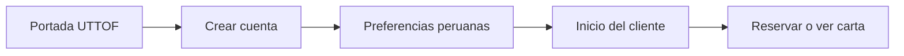
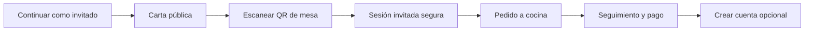
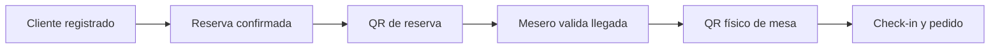
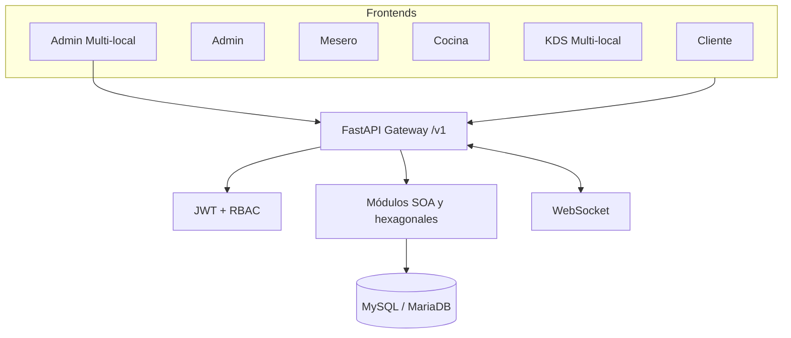

# UTTOF Restaurant

[](https://github.com/JheissonLoor/UUTOF-restaurant/actions/workflows/ci.yml)
[](https://fastapi.tiangolo.com)
[](https://react.dev)
[](https://www.sqlalchemy.org/)
[](backend/tests/)

Plataforma peruana de gestión integral para restaurantes, construida como proyecto académico de Arquitectura de Software. UTTOF conecta atención al cliente, salón, cocina en tiempo real (KDS) y administración sobre un backend asíncrono común con seguridad por roles (RBAC).

La solución está localizada para Perú: moneda `PEN`, formato `S/`, zona horaria `America/Lima`, flujo de pagos QR con Yape y validación telefónica `+51`.

## Arquitectura del Sistema

- **Backend Relacional Asíncrono:** Desarrollado en **FastAPI** con motor asíncrono **SQLAlchemy** y pool de conexiones **asyncmy** sobre MariaDB / MySQL.
- **Pantalla de Cocina en Tiempo Real (KDS):** Monitor de preparación de comandas con actualización de estados en tiempo real, cronómetros y control por ítems.
- **Diseño Orientado al Dominio:** Separación en capas modulares (entidad, aplicación, infraestructura y presentación) para reservas, comandas, mesas y pagos.
- **Testing Automatizado:** Suite de 20 pruebas unitarias y de validación de esquemas ejecutadas con **Pytest** en pipeline automatizado de CI.

## Experiencias del sistema

| Aplicación | Ruta | Propósito |
| --- | --- | --- |
| Cliente público | `frontend/cliente` | Portada del restaurante, carta, reservas, QR de mesa, pedidos y pagos |
| Panel Admin Pro | `frontend/admin` | Dashboard, menú, mesas, empleados, reservas, reportes y configuración |
| App Mesero Pro | `frontend/mesero` | Mesas, pedidos, cobros, efectivo y validación de reservas |
| Cocina Pro | `frontend/cocina` | Kanban operativo con polling |
| KDS Multi-local | `frontend/kds` | Cocina avanzada en tiempo real, cronómetros, sonido e ítems individuales |
| Plan Estándar | `frontend/standard` | Aplicación unificada para los cuatro roles |
| Admin Multi-local | `frontend/admin-multilocal` | Consolidado de la red, sucursales, IA, inventario, reportes, personal e integraciones |

## Flujos principales







## Dos QR, dos responsabilidades

| QR | Ubicación | Función |
| --- | --- | --- |
| QR de reserva | App del cliente | Identifica una reserva confirmada; Mesero lo valida al recibir al cliente |
| QR de mesa | Impreso en cada mesa | Inicia la visita, crea o recupera la sesión y habilita pedidos |

El QR de mesa usa una URL HTTPS con token opaco y un código corto de respaldo. Los QR históricos `uttof://mesa/{id}` continúan funcionando durante la transición.

## Arquitectura



El backend es un monolito modular con tres grupos:

- `utilidad`: autenticación, RBAC, configuración y tiempo real.
- `entidad`: usuario, menú, mesa, pedido, reserva, pago y reseña.
- `tarea`: reportes y flujos coordinados.

Los módulos principales separan `dominio`, `aplicacion` e `infraestructura`.

## Stack

- Python 3.11, FastAPI y SQLAlchemy async.
- MySQL 8 o MariaDB mediante `asyncmy`.
- React 18, TypeScript, Vite y Tailwind CSS.
- JWT HS256, bcrypt cost 12 y RBAC.
- WebSocket para eventos operativos.
- ZXing para lectura real de QR.

El documento técnico navegable se encuentra en `docs/arquitectura.html`.

## Seguridad y acceso

- Access token de 15 minutos y refresh token de 7 días.
- Roles técnicos: `admin`, `dueno`, `gerente_sucursal`, `mesero`, `cocina` y `cliente`.
- El dueño puede consultar toda la red; cada gerente queda limitado por backend a su `id_sucursal` incluido en el JWT.
- SQL parametrizado en los repositorios.
- Errores HTTP en Problem Details (`application/problem+json`).
- Las sesiones invitadas usan usuarios anónimos sin datos personales y pueden convertirse en cuentas registradas conservando pedidos.
- Google, Apple y SMS aparecen como `Próximamente`; no simulan autenticación.

## Preparación local

Requisitos:

- Python 3.11.
- Node.js y npm.
- MySQL/MariaDB o XAMPP.

### Base de datos

```powershell
cd backend
copy .env.example .env
Get-Content .\database\init_db.sql | C:\xampp\mysql\bin\mysql.exe -u root -p
Get-Content .\app\db\migrations.sql | C:\xampp\mysql\bin\mysql.exe -u uttof_user -p uttof_db
Get-Content .\app\db\003_mesero_app.sql | C:\xampp\mysql\bin\mysql.exe -u uttof_user -p uttof_db
Get-Content .\app\db\004_kds_premium.sql | C:\xampp\mysql\bin\mysql.exe -u uttof_user -p uttof_db
Get-Content .\app\db\005_pago_efectivo_pendiente.sql | C:\xampp\mysql\bin\mysql.exe -u uttof_user -p uttof_db
Get-Content .\app\db\006_cliente_onboarding_qr.sql | C:\xampp\mysql\bin\mysql.exe -u uttof_user -p uttof_db
Get-Content .\app\db\007_multilocal_base.sql | C:\xampp\mysql\bin\mysql.exe -u uttof_user -p uttof_db
Get-Content .\app\db\008_inventario_multilocal.sql | C:\xampp\mysql\bin\mysql.exe -u uttof_user -p uttof_db
Get-Content .\app\db\009_ia_multilocal.sql | C:\xampp\mysql\bin\mysql.exe -u uttof_user -p uttof_db
Get-Content .\app\db\010_operacion_multilocal.sql | C:\xampp\mysql\bin\mysql.exe -u uttof_user -p uttof_db
Get-Content .\app\db\011_config_empresa.sql | C:\xampp\mysql\bin\mysql.exe -u uttof_user -p uttof_db
python -m app.db.seed
```

Si `mysql` está disponible en `PATH`, reemplaza `C:\xampp\mysql\bin\mysql.exe` por `mysql`.

### Backend

```powershell
cd backend
python -m venv .venv
.\.venv\Scripts\Activate.ps1
pip install -r requirements.txt
uvicorn app.main:app --reload --host 127.0.0.1 --port 8000
```

- Health: `http://127.0.0.1:8000/health`
- Swagger: `http://127.0.0.1:8000/docs`

### Frontends

Cada aplicación se levanta en una terminal diferente:

```powershell
cd frontend\admin; npm.cmd install; npm.cmd run dev
cd frontend\mesero; npm.cmd install; npm.cmd run dev
cd frontend\cocina; npm.cmd install; npm.cmd run dev
cd frontend\cliente; npm.cmd install; npm.cmd run dev
cd frontend\kds; npm.cmd install; npm.cmd run dev
cd frontend\standard; npm.cmd install; npm.cmd run dev
cd frontend\admin-multilocal; npm.cmd install; npm.cmd run dev
```

| Servicio | URL local |
| --- | --- |
| Admin | `http://127.0.0.1:5173` |
| Mesero | `http://127.0.0.1:5174` |
| Cocina Pro | `http://127.0.0.1:5175` |
| Cliente público | `http://127.0.0.1:5176` |
| KDS Multi-local | `http://127.0.0.1:5177` |
| Plan Estándar | `http://127.0.0.1:5178` |
| Admin Multi-local | `http://127.0.0.1:5179` |

## Cuentas de demostración

| Rol | Correo | Contraseña |
| --- | --- | --- |
| Admin | `admin@uttof.pe` | `admin123` |
| Mesero | `mesero@uttof.pe` | `mesero123` |
| Cocina | `cocina@uttof.pe` | `cocina123` |
| Cliente | `cliente@uttof.pe` | `cliente123` |
| Dueño de la red | `dueno@uttof.pe` | `dueno123` |
| Gerente Miraflores | `gerente.miraflores@uttof.pe` | `gerente123` |
| Gerente Barranco | `gerente.barranco@uttof.pe` | `gerente123` |
| Gerente San Isidro | `gerente.sanisidro@uttof.pe` | `gerente123` |

La App Cliente ya no inicia automáticamente con la cuenta demo.

## Configuración de despliegue

- Backend: `PUBLIC_CLIENT_URL=https://app.uttof.pe`.
- Cliente: `VITE_API_URL=https://api.uttof.pe/v1`.
- Todos los frontends deben agregarse a `CORS_ORIGINS`.
- La cámara requiere HTTPS fuera de `localhost` y `127.0.0.1`.
- Dirección, horarios, teléfono y medios de pago se administran desde Configuración del Panel Admin.

## Verificación

```powershell
cd backend
.\.venv\Scripts\python.exe -m pytest -q
.\.venv\Scripts\python.exe -m compileall -q app

cd frontend\cliente
npm.cmd run lint
npm.cmd run build

cd ..\admin
npm.cmd run build

cd ..\mesero
npm.cmd run build

cd ..\standard
npm.cmd run lint
npm.cmd run build

cd ..\admin-multilocal
npm.cmd run lint
npm.cmd run build

cd ..\..\backend
.\.venv\Scripts\python.exe tools\verify_e2e.py
```

## Estado actual

Implementado: backend modular, autenticación y RBAC, carta, mesas, pedidos, pagos, reservas, reportes, configuración, aplicaciones Estándar y Operación Pro, KDS, Admin Multi-local, portada pública, onboarding peruano, preferencias persistentes, invitado convertible y ambos flujos QR.

El verificador integral crea datos temporales, recorre `QR de mesa → invitado → pedido → cocina → entrega → pago → cuenta → preferencias → reserva → validación del mesero` y limpia esos datos al terminar.

Pendiente para una salida pública definitiva: aislamiento por restaurante o tenant, contratación y control de capacidades por plan, dominio, certificados HTTPS, proveedor real de tarjeta/Yape, correo/SMS transaccional, observabilidad, copias de seguridad gestionadas y pruebas de seguridad y carga. Las integraciones configurables y la predicción operativa actuales son demostrables, pero no sustituyen todavía conexiones certificadas con proveedores ni una plataforma externa de machine learning.
